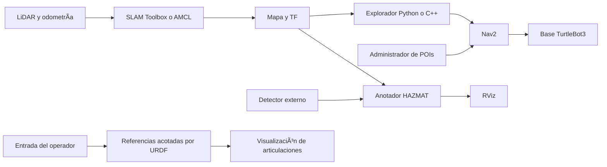

# Arquitectura e interfaces

## Paquetes

Los paquetes propios están en `src/`; el código externo se conserva en `external/` y queda fuera de la búsqueda de colcon.

## Navegación

`mission_launch.py` selecciona SLAM o localización con mapa guardado mediante Nav2 bringup. La fuente global de mapa y TF depende de ese modo. El explorador puede ser Python, C++ o ninguno.

El explorador Python y el administrador de POIs comparten `autonomy_common.NavigationTask`. Este componente envía solicitudes asíncronas, procesa aceptación y resultados, y solicita cancelación al vencer el tiempo límite. Mantiene la propiedad del objetivo hasta recibir un resultado terminal. El explorador C++ implementa el mismo contrato dentro de su ejecutor de un solo hilo.

Solo un cliente de misión debe estar activo. Este contrato evita superposiciones dentro de cada cliente; no impide que un operador o un cliente externo sustituya un objetivo en Nav2.

Las fronteras se agrupan por conectividad de ocho vecinos. El destino es una celda libre del grupo próxima a su centro, con margen de obstáculos conocidos. Se consideran el origen rotado del OccupancyGrid, los límites de reintentos y las visitas confirmadas por Nav2. La utilidad resta una penalización de distancia al área desconocida; no representa un coste de trayectoria calculado por el planificador.

## Datos

| Interfaz | Tipo | Contrato |
|---|---|---|
| `map` | `nav_msgs/OccupancyGrid` | Mapa planar válido en el marco global; suscripción transitoria local |
| `navigate_to_pose` | `nav2_msgs/action/NavigateToPose` | Nav2 activo y configurado para la base |
| `scan` → `adjusted_scan` | `sensor_msgs/LaserScan` | Geometría coherente, QoS de sensores y reducción opcional de rayos |
| `hazmat_publisher` | `std_msgs/String` | Etiqueta recibida; `No detections` no genera observación |
| `odom` | `nav_msgs/Odometry` | Pose sellada en `header.frame_id`, transformable al mapa |
| `hazmat_markers` | `visualization_msgs/MarkerArray` | Conjunto acotado de ubicaciones de observación |
| `motor1_position`, `motor2_position` | `std_msgs/Float32` | Referencias finitas en radianes, limitadas por URDF |
| `joint_states` | `sensor_msgs/JointState` | Representación de referencias; no realimentación física |

Los nombres son relativos y admiten remapeo ROS. `map_frame` y `robot_frame` se configuran mediante parámetros.

## Responsabilidades físicas

Nav2 controla trayectorias y recuperación de la base. Los nodos de misión no sustituyen el paro físico. El mecanismo necesita un controlador de actuadores independiente. La anotación HAZMAT registra la posición del robot al recibir una etiqueta; localizar el objeto requiere información geométrica adicional del sistema de percepción.
